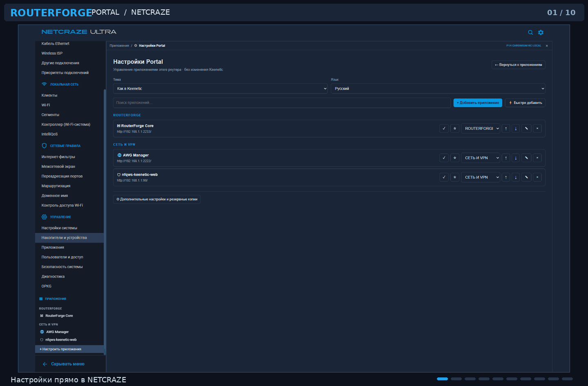

# RouterForge Portal 1.0.0 🚀

**Приложения Keenetic, локальные веб-сервисы и удалённые серверы — в одном интерфейсе браузера.**

[🇷🇺 Русский](README.md) · [🇬🇧 English](README_EN.md)

### [🧩 Chrome Web Store](https://chromewebstore.google.com/detail/ikghhhcbgfepddcjammfhaeomohfajij) · [🌐 Официальный сайт](https://fifth-ace.github.io/routerforge-portal/) · [📦 Релиз 1.0.0](https://github.com/Fifth-Ace/routerforge-portal/releases/tag/v1.0.0)

**Chromium: расширение в магазине** · **Firefox: ожидает модерации Mozilla** · **Tampermonkey / Violentmonkey: userscript**

---

## Что такое Portal?

RouterForge Portal встраивает меню веб-приложений и список подключённых серверов в **Keenetic / NETCRAZE WebUI**. Сервисные панели можно открывать внутри интерфейса роутера либо отдельной вкладкой. Для работы **не нужно устанавливать Portal на роутер, использовать RouterForge Core или создавать облачный аккаунт**.

## Возможности стабильной версии 1.0.0

| Раздел | Возможности |
|---|---|
| 🧩 **Keenetic WebUI** | Боковое меню приложений и серверов, категории, избранное, поиск, недавние приложения |
| 🖥️ **Несколько роутеров** | Независимые профили, выбранный и основной роутер, свои настройки и приложения |
| 🪟 **Рабочая область** | До 3 открытых вкладок сессии, встроенные панели, отдельная вкладка, настройка ширины и границ |
| 📚 **Каталог** | RouterForge Core, AWG Manager, nfqws и другие сервисы Keenetic/Entware; добавление своих URL |
| 🖧 **Серверы** | Локальные и внешние серверы, несколько панелей на сервер, полные URL и нестандартные порты |
| 📊 **3x-ui** | HTTP RTT, CPU, RAM, диск, Xray, доступные показатели трафика, ручная диагностика и опрос 1–60 мин |
| 🔐 **Portal Vault** | Шифрованное локальное хранилище токенов и учётных данных с мастер-паролем |
| 💾 **Полный бэкап** | Зашифрованный экспорт/импорт профилей Keenetic, серверов, приложений, настроек и Vault |
| 🎨 **Интерфейс** | RU/EN, светлая/тёмная/системная темы, компактные карточки и popup |

Мониторинг и обращения к серверным API зависят от разрешений браузера, токенов и явного согласия пользователя. Встраивание сторонней страницы может быть запрещено её CSP или X-Frame-Options — тогда используй отдельную вкладку.

## Установка

| Платформа | Канал | Установка |
|---|---|---|
| **Google Chrome** | Chrome Web Store | [Установить расширение](https://chromewebstore.google.com/detail/ikghhhcbgfepddcjammfhaeomohfajij) |
| **Edge, Brave, Opera, Vivaldi и другие совместимые Chromium** | Магазин, если поддерживается, или ручной ZIP | [Chromium ZIP 1.0.0](https://github.com/Fifth-Ace/routerforge-portal/releases/download/v1.0.0/routerforge-portal-chromium-v1.0.0.zip) |
| **Mozilla Firefox** | Нативное дополнение ожидает проверки AMO | Пока доступен [userscript](https://github.com/Fifth-Ace/routerforge-portal/releases/download/v1.0.0/routerforge-portal.user.js) через менеджер |
| **Tampermonkey / Violentmonkey** | Userscript для WebUI Keenetic | [Установить .user.js](https://github.com/Fifth-Ace/routerforge-portal/releases/download/v1.0.0/routerforge-portal.user.js) |

[📦 Все файлы 1.0.0](https://github.com/Fifth-Ace/routerforge-portal/releases/tag/v1.0.0) · [🔒 Контрольные суммы](https://github.com/Fifth-Ace/routerforge-portal/releases/download/v1.0.0/SHA256SUMS.txt) · [Инструкция RU](docs/INSTALL-RU.md) · [Installation EN](docs/INSTALL-EN.md)

**Каналы распространения:** Chrome Web Store уже публикует Portal, но обновление именно до **1.0.0** может появиться позднее после проверки магазина. ZIP из GitHub — самостоятельный ручной канал. **Firefox XPI в Assets неподписан и предназначен только для тестирования**, не для обычной установки.

**Userscript:** Tampermonkey/Violentmonkey обеспечивают интеграцию приложений в Keenetic WebUI. **Portal Vault, удалённые серверы и мониторинг 3x-ui относятся к браузерному расширению**, не обещаются в userscript.

### Обновление без потери данных

Для установленного из магазина расширения дождись обновления через магазин. Не удаляй существующую установку: профили, серверы и Vault хранятся локально по идентификатору расширения. При переходе между магазинной и распакованной версиями их хранилища могут отличаться — заранее создай **полный защищённый бэкап**. Пароль бэкапа и мастер-пароль Vault могут быть разными.

Не включай нативное расширение и userscript на одной странице роутера одновременно — появится дублирующее меню.

## Как выглядит

Демонстрация интеграции веб-приложений в Keenetic. Полный интерфейс серверов и Vault появился позднее и не показан на исторической анимации.

## Приватность и безопасность

Данные Portal сохраняются **локально в браузере**. Учётные данные и токены, если пользователь их добавил, хранятся зашифрованными в Vault; защищённый бэкап использует PBKDF2-SHA256 и AES-256-GCM. Сам Portal не предоставляет разработчику облачный доступ к пользовательским данным. Разрешения на серверы и внешние веб-панели выдаются пользователем.

[Политика приватности](PRIVACY.md) · [Безопасность](SECURITY.md) · [Сообщить об ошибке](https://github.com/Fifth-Ace/routerforge-portal/issues)

**RouterForge Portal — независимое неофициальное расширение для Keenetic / NETCRAZE.** [RouterForge Ecosystem](https://github.com/Fifth-Ace/routerforge) · [Telegram](https://t.me/RouterForge) · [MIT](LICENSE)
