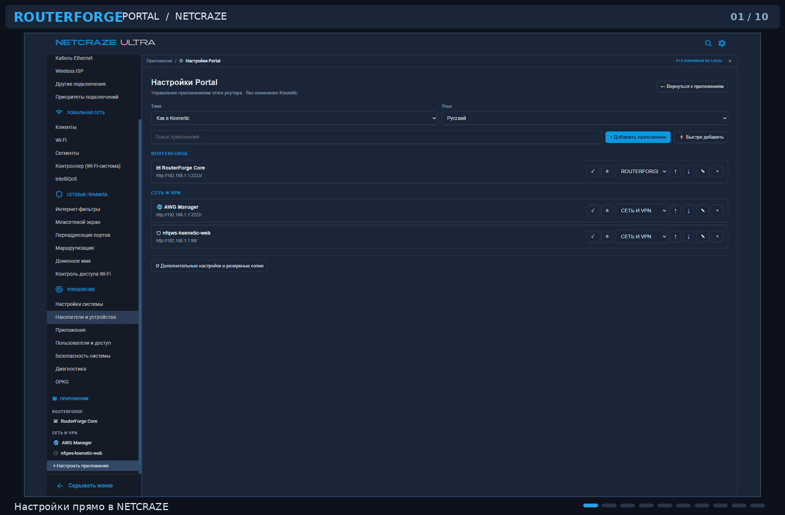

# RouterForge Portal

**One place for Keenetic / Netcraze web applications. Right inside your browser.**

Put AWG Manager, RouterForge Core, nfqws and other web panels into your router's familiar navigation — without installing extra components on the router.

[**🇷🇺 Русский**](README.md) · [**🇬🇧 English**](README_EN.md)

### [📦 Download v0.10.1 for all channels](https://github.com/Fifth-Ace/routerforge-portal/releases/latest) · [💬 Telegram](https://t.me/RouterForge)

[Features](#features) · [Install](#installation) · [Screenshots](#screenshots) · [FAQ](#faq)

---

## What is it?

**RouterForge Portal** brings the web interfaces of existing router services together. It adds an Applications section to the Keenetic interface, offers a catalog of known integrations, and remembers hosts, ports and launch modes.

> [!IMPORTANT]
> Portal **does not install** services on your router and **does not replace** the Keenetic interface. Each web application must already be installed and reachable.

## Install — v0.10.1 (Chromium)

**v0.10.1 channels:** Chromium MV3 ZIP for Chrome/Edge/Opera; userscript for Tampermonkey/Violentmonkey in supported browsers (including Firefox); unsigned Firefox XPI for temporary development testing only, not permanent installation.

1. [Download the Chromium ZIP v0.10.1](https://github.com/Fifth-Ace/routerforge-portal/releases/download/v0.10.1/routerforge-portal-chromium-v0.10.1.zip).
2. Extract it to a permanent folder.
3. In `chrome://extensions`, `edge://extensions` or `opera://extensions`, enable **Developer Mode** and select **Load unpacked**.
4. Sign into NETCRAZE/Keenetic and grant permission to access the router address when prompted. After a JSON import, click Grant access and reload tab in the Portal popup if the site permission is missing.

**Other channels:** Release assets include `routerforge-portal.user.js`, `.meta.js` (Tampermonkey/Violentmonkey) and `routerforge-portal-firefox-UNSIGNED-DEV-v0.10.1.xpi` (temporary testing only). Do not run userscript and native extension together on one router page.

**Updating from v0.9.0:** export your profiles to JSON first. Replace the files in the **same installed folder**, then click Reload; avoid removing the extension until your settings are verified. The [historical v0.9.0 release](https://github.com/Fifth-Ace/routerforge-portal/releases/tag/v0.9.0), including its userscript, is left untouched.

**[Full English instructions](docs/INSTALL-EN.md)** · [Инструкция на русском](docs/INSTALL-RU.md).

## Screenshots

  

Ten real NETCRAZE Ultra screenshots supplied by a user: Portal settings, nfqws2, AWG Manager, RouterForge Core and the app catalog, displayed inside the native NETCRAZE/Keenetic WebUI. The animation loops; click it for a larger view.

## Features

| | What it does |
|:---|:---|
| 🧩 **Unified menu** | Adds Applications navigation to the native Keenetic WebUI after login. |
| 📚 **Built-in catalog** | RouterForge Core, AWG Manager, nfqws-keenetic-web, nfqws2-ui, NeoFit, AdGuard Home and XKeen UI. |
| 🛠️ **Custom services** | Add any web panel by URL and port; configure multiple routers. |
| 🪟 **Two launch modes** | Embedded within Keenetic or a separate browser tab. When CSP/X-Frame-Options block embedding, use a tab. |
| 🎨 **Appearance** | Dark/light themes and Russian/English UI. |
| 💾 **Profiles** | Local settings, JSON import and export. |
| 🗂️ **Workspace** | Up to three live iframe tabs, favorites, groups, settings inside Keenetic. |
| 📐 **Responsive** | Respects the native WebUI boundaries when the browser window is resized. |
| 🔄 **Updates** | Manual updates for the native unpacked extension; no silent code installation. |

## FAQ

<b>Is RouterForge Core required?</b>

No. Portal is independent. The specific web service you want to open must already be installed and reachable.

<b>Why does a service open in a separate tab?</b>

Some services prevent iframe embedding through CSP or X-Frame-Options. Portal does not bypass these protections. Choose a separate tab instead.

<b>Can I use the userscript and the native extension together?</b>

Avoid doing so on the same router page: it will duplicate the menu. Choose one channel; JSON export/import can migrate settings between them.

<b>Are updates secure and automatic?</b>

Legacy v0.9.0 userscript managers could check GitHub Release update links, but they do **not** validate GitHub build attestations. Native extensions do not silently replace their executable code; verify release file hashes and update your unpacked extension manually. [Read the security policy](SECURITY.md).

## Privacy and development

Portal keeps router profiles in the browser, never requests Keenetic passwords, does not scan the network and sends no developer telemetry. The native extension contacts GitHub for updates only when you click the check button. **[Privacy](PRIVACY.md)** · **[Report a problem](https://github.com/Fifth-Ace/routerforge-portal/issues)**.

Open source · [MIT License](LICENSE) · [RouterForge project](https://github.com/Fifth-Ace/routerforge) · [Telegram](https://t.me/RouterForge)

RouterForge Portal is an independent, unofficial Keenetic / Netcraze companion and is not affiliated with the device manufacturers.
