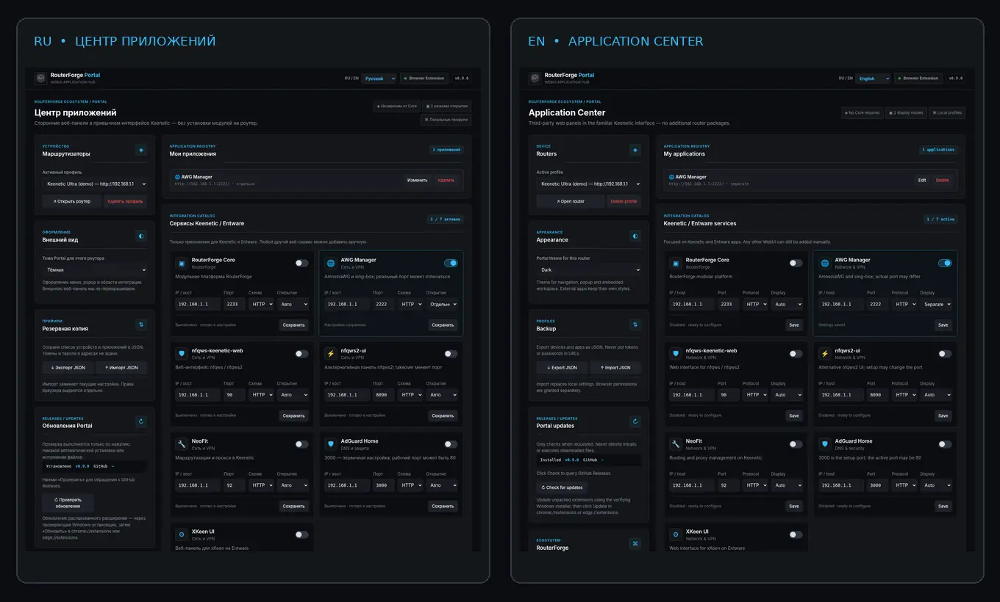
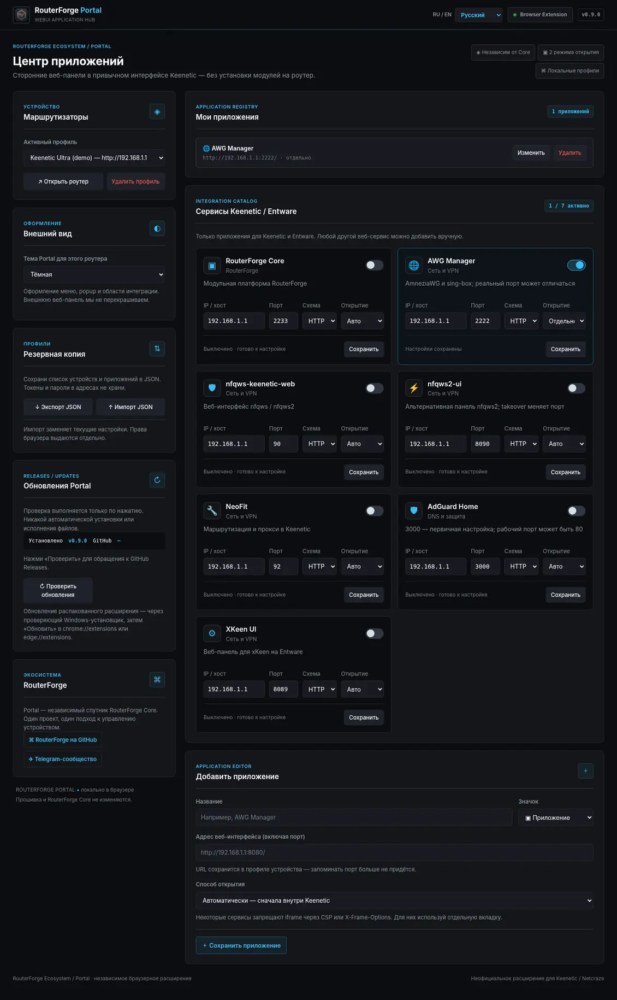
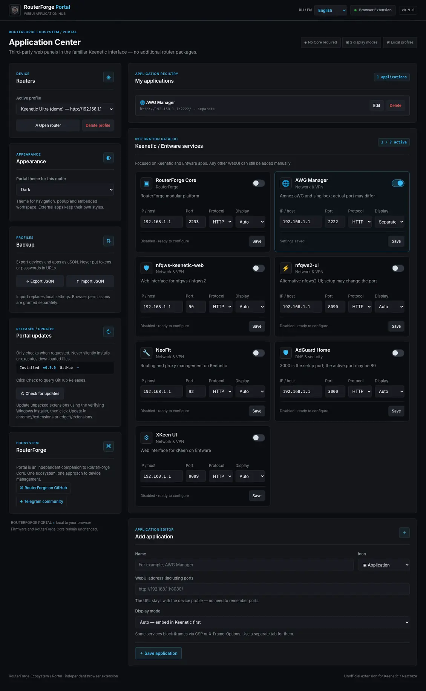
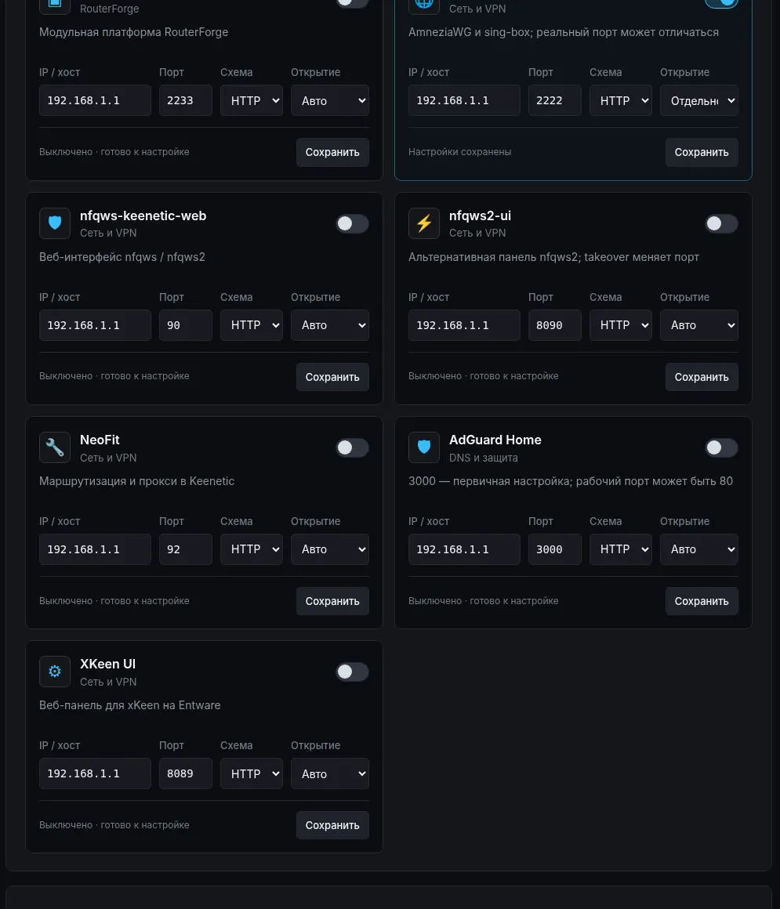

# RouterForge Portal

**One place for Keenetic / Netcraze web applications. Right inside your browser.**

Put AWG Manager, RouterForge Core, nfqws and other web panels into your router's familiar navigation — without installing extra components on the router.

[**🇷🇺 Русский**](README.md) · [**🇬🇧 English**](README_EN.md)

### [📦 Download](https://github.com/Fifth-Ace/routerforge-portal/releases/latest) · [⚡ Install with Tampermonkey](https://github.com/Fifth-Ace/routerforge-portal/releases/latest/download/routerforge-portal.user.js) · [💬 Telegram](https://t.me/RouterForge)

[Features](#features) · [Install](#installation) · [Screenshots](#screenshots) · [FAQ](#faq)

---

## What is it?

**RouterForge Portal** brings the web interfaces of existing router services together. It adds an Applications section to the Keenetic interface, offers a catalog of known integrations, and remembers hosts, ports and launch modes.

> [!IMPORTANT]
> Portal **does not install** services on your router and **does not replace** the Keenetic interface. Each web application must already be installed and reachable.

## Installation

### Option 1 — Tampermonkey / Violentmonkey (easiest)

Compatible with **Chrome, Edge, Opera and Firefox** through a userscript manager.

1. Install [Tampermonkey](https://www.tampermonkey.net/) or [Violentmonkey](https://violentmonkey.github.io/).
2. Open **[routerforge-portal.user.js — install userscript](https://github.com/Fifth-Ace/routerforge-portal/releases/latest/download/routerforge-portal.user.js)** and confirm installation in the userscript manager. If your browser downloads the file instead, import it from the manager's dashboard.
3. Open the Keenetic WebUI and sign in. Portal appears only after login. Configure integrations using the Tampermonkey / Violentmonkey menu.

> [!NOTE]
> Recent Chromium versions may require **Allow User Scripts** in Tampermonkey's extension settings, and possibly Developer Mode depending on the manager. Check your manager's documentation.

### Option 2 — native Chrome / Edge / Opera extension

1. **[Download Chromium ZIP v0.9.0](https://github.com/Fifth-Ace/routerforge-portal/releases/download/v0.9.0/routerforge-portal-chromium-v0.9.0.zip)** and unzip it to a permanent folder.
2. Open `chrome://extensions`, `edge://extensions` or `opera://extensions`; enable **Developer Mode**.
3. Select **Load unpacked**, then choose the folder containing `manifest.json`.
4. Open Keenetic and grant Portal access to your router's address when prompted by the browser.

**Firefox:** use the userscript for normal use. The release's `firefox-UNSIGNED-DEV.xpi` is **not Mozilla-signed** and is intended only for temporary `about:debugging` tests, not permanent installation.

**[Full installation guide (English)](docs/INSTALL-EN.md)** · [Инструкция на русском](docs/INSTALL-RU.md) · [All releases](https://github.com/Fifth-Ace/routerforge-portal/releases)

## Screenshots

Chromium screenshots of Portal v0.9.0 with a demo Keenetic profile — not a live router.

<b>More screenshots: Russian and English settings, integration catalog</b>

| Russian settings | English settings |
|:---:|:---:|
|  |  |

Integration catalog close-up

## Features

| | What it does |
|:---|:---|
| 🧩 **Unified menu** | Adds Applications navigation to the native Keenetic WebUI after login. |
| 📚 **Built-in catalog** | RouterForge Core, AWG Manager, nfqws-keenetic-web, nfqws2-ui, NeoFit, AdGuard Home and XKeen UI. |
| 🛠️ **Custom services** | Add any web panel by URL and port; configure multiple routers. |
| 🪟 **Two launch modes** | Embedded within Keenetic or a separate browser tab. When CSP/X-Frame-Options block embedding, use a tab. |
| 🎨 **Appearance** | Dark/light themes and Russian/English UI. |
| 💾 **Profiles** | Local settings, JSON import and export. |
| 🔄 **Updates** | Userscript updates through the manager; native ZIP installation is updated manually. |

## FAQ

<b>Is RouterForge Core required?</b>

No. Portal is independent. The specific web service you want to open must already be installed and reachable.

<b>Why does a service open in a separate tab?</b>

Some services prevent iframe embedding through CSP or X-Frame-Options. Portal does not bypass these protections. Choose a separate tab instead.

<b>Can I use the userscript and the native extension together?</b>

Avoid doing so on the same router page: it will duplicate the menu. Choose one channel; JSON export/import can migrate settings between them.

<b>Are updates secure and automatic?</b>

Userscript managers can check GitHub Release update links, but they do **not** validate GitHub build attestations. Native extensions do not silently replace their executable code; verify release file hashes and update your unpacked extension manually. [Read the security policy](SECURITY.md).

## Privacy and development

Portal keeps router profiles in the browser, never requests Keenetic passwords, does not scan the network and sends no developer telemetry. The native extension contacts GitHub for updates only when you click the check button. **[Privacy](PRIVACY.md)** · **[Report a problem](https://github.com/Fifth-Ace/routerforge-portal/issues)**.

Open source · [MIT License](LICENSE) · [RouterForge project](https://github.com/Fifth-Ace/routerforge) · [Telegram](https://t.me/RouterForge)

RouterForge Portal is an independent, unofficial Keenetic / Netcraze companion and is not affiliated with the device manufacturers.
