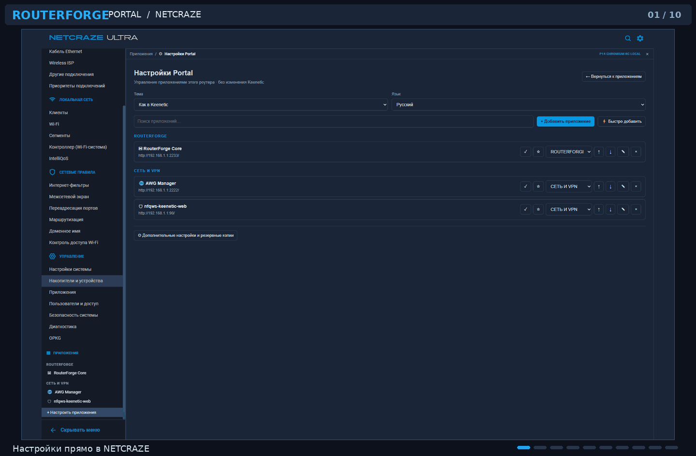

# RouterForge Portal 1.0.0 🚀

**Keenetic web apps, local services and remote servers — one browser dashboard.**

[🇷🇺 Русский](README.md) · [🇬🇧 English](README_EN.md)

### [🧩 Chrome Web Store](https://chromewebstore.google.com/detail/ikghhhcbgfepddcjammfhaeomohfajij) · [🌐 Website](https://fifth-ace.github.io/routerforge-portal/) · [📦 Release 1.0.0](https://github.com/Fifth-Ace/routerforge-portal/releases/tag/v1.0.0)

**Chromium: store listing live** · **Firefox: Mozilla review pending** · **Tampermonkey / Violentmonkey: userscript**

---

## What is RouterForge Portal?

Portal brings web applications and connected-server shortcuts into **Keenetic / NETCRAZE WebUI**. Open apps inside your router interface or in a separate browser tab. **No router-side Portal package, mandatory RouterForge Core installation or cloud account required.**

## Stable 1.0.0 capabilities

| Area | Highlights |
|---|---|
| 🧩 **Keenetic WebUI** | Sidebar with applications and servers, favorites, groups, search and recent apps |
| 🖥️ **Multiple routers** | Separate profiles and per-router preferences |
| 🪟 **Workspace** | Up to 3 live session tabs, embedded/external opening, width and boundary controls |
| 📚 **Catalog** | RouterForge Core, AWG Manager, nfqws and other Keenetic/Entware apps, custom URLs |
| 🖧 **Servers** | Local and remote servers, multiple panels per server, full URLs and custom ports |
| 📊 **3x-ui** | HTTP RTT, CPU, RAM, disk, Xray, available traffic metrics, manual checks and 1–60 min polling |
| 🔐 **Portal Vault** | Local encrypted credentials and API tokens protected by a master password |
| 💾 **Full backup** | Encrypted export/import of Keenetic profiles, apps, servers, preferences and Vault |
| 🎨 **UI** | Russian/English, light/dark/system themes, responsive cards and compact popup |

Monitoring and remote API access depend on browser permissions, credentials and explicit user consent. Third-party CSP / X-Frame-Options may block embedding; use the external-tab mode instead.

## Installation

| Browser | Channel | Install |
|---|---|---|
| **Google Chrome** | Chrome Web Store | [Install extension](https://chromewebstore.google.com/detail/ikghhhcbgfepddcjammfhaeomohfajij) |
| **Edge, Brave, Opera, Vivaldi and compatible Chromium** | Store when supported, or manual ZIP | [Chromium ZIP 1.0.0](https://github.com/Fifth-Ace/routerforge-portal/releases/download/v1.0.0/routerforge-portal-chromium-v1.0.0.zip) |
| **Mozilla Firefox** | Native extension under AMO review | [Userscript](https://github.com/Fifth-Ace/routerforge-portal/releases/download/v1.0.0/routerforge-portal.user.js) for now |
| **Tampermonkey / Violentmonkey** | Keenetic WebUI userscript | [Install .user.js](https://github.com/Fifth-Ace/routerforge-portal/releases/download/v1.0.0/routerforge-portal.user.js) |

[📦 All 1.0.0 assets](https://github.com/Fifth-Ace/routerforge-portal/releases/tag/v1.0.0) · [🔒 SHA256 checksums](https://github.com/Fifth-Ace/routerforge-portal/releases/download/v1.0.0/SHA256SUMS.txt) · [Russian guide](docs/INSTALL-RU.md) · [English guide](docs/INSTALL-EN.md)

**Store version note:** The Chrome Web Store listing is live, but the **1.0.0 update may still be awaiting store review**. The GitHub ZIP is a separate manual channel. The Firefox XPI supplied in GitHub Assets is **unsigned and development-only**; it is not a published AMO add-on.

**Userscript scope:** Tampermonkey/Violentmonkey provide Keenetic WebUI app integration. **Portal Vault, external server management and 3x-ui monitoring are native-extension features**, not promised in the userscript.

### Preserve your data during upgrades

Keep your existing extension installed when updating. Browser-local profiles, servers and Vault are associated with an extension ID; Chrome Web Store and unpacked installs can use separate storage. Export a **full encrypted backup** before switching channels. Backup and Vault master passwords may differ.

Do not run the native extension and userscript on the same router page simultaneously; this creates duplicate menus.

## Preview

Historical Keenetic app integration demo; the 1.0.0 server/Vault interface is not shown in this animation.

## Privacy & security

Portal keeps its data **locally in your browser**. User-added credentials and tokens are encrypted in the Vault; encrypted backups use PBKDF2-SHA256 and AES-256-GCM. Portal does not provide developers with a cloud copy of your settings. External host access requires browser permission.

[Privacy](PRIVACY.md) · [Security](SECURITY.md) · [Report an issue](https://github.com/Fifth-Ace/routerforge-portal/issues)

**RouterForge Portal is an independent, unofficial Keenetic / NETCRAZE extension.** [RouterForge Ecosystem](https://github.com/Fifth-Ace/routerforge) · [Telegram](https://t.me/RouterForge) · [MIT](LICENSE)
